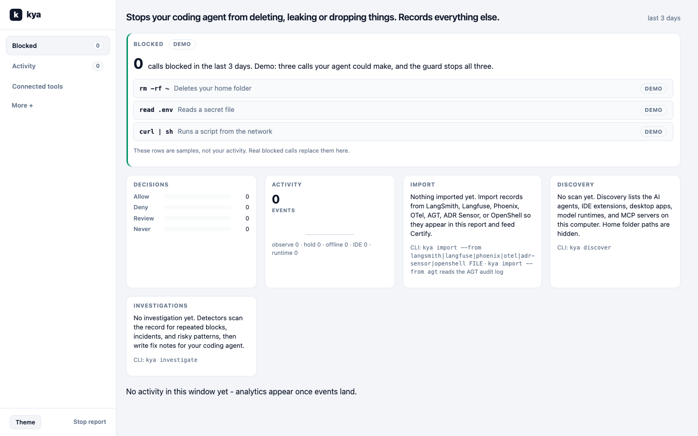

# `@shield-agent/kya`

**Stops your coding agent from deleting, leaking or dropping things.** Records everything else.

```bash
npm i -g @shield-agent/kya@latest && kya start
```



## What you get

KYA blocks a short list of destructive commands, secret reads and exfiltration by default ([list below](#what-it-blocks-by-default)), and records every other tool call on a local dashboard. One command. Free forever under MIT. The limits are in [LIMITATIONS.md](LIMITATIONS.md).

```bash
# Permission denied (EACCES) on Linux? No sudo and no install needed:
npx @shield-agent/kya@latest start
```

Requires **Node.js 22+** (24 recommended). Restart Cursor / Claude Code / Codex once so MCP loads. Hosted desk: [shield-agent.com](https://shield-agent.com/install).

[](https://www.npmjs.com/package/@shield-agent/kya)
[](https://www.npmjs.com/package/@shield-agent/kya)
[](https://www.npmjs.com/package/@shield-agent/kya)
[](./LICENSE)
[](https://shield-agent.com/install)
[](https://shield-agent.com/replays)
[](https://x.com/coscosmico)
[](https://glama.ai/mcp/servers/The-Pixel-Boys/shield-kya)

## What it blocks by default

The deny list is the never-list ([docs/never-list.md](docs/never-list.md)) plus the guard pack ([docs/guard-pack.md](docs/guard-pack.md)). A deny exits `2` and names its rule id. In plain words:

- **Wiping files.** `rm` with recursive and force flags on `/`, your home directory, a parent of it or of the project folder (`rm-root-home`, and `rm-recursive-home-or-system`); `find ... -delete` on home or system folders.
- **Infrastructure and data.** `terraform destroy` and `terraform apply -destroy` (`terraform-destroy`); `DROP TABLE`, `DROP DATABASE`, `DROP SCHEMA` and `TRUNCATE` inside a database client (`sql-drop`); `docker volume rm`, `docker volume prune`, `docker system prune --volumes` and `docker compose down -v` (`docker-volumes`); `kubectl delete namespace` and `kubectl delete --all -A` (`k8s-delete-ns`); `aws ec2 terminate-instances`, `aws s3 rb --force`, `aws s3 rm --recursive`, `aws rds delete-db-instance`, `gcloud projects delete`, `gcloud sql instances delete`, `az group delete` (`cloud-delete`); `railway volume delete` and a `volumeDelete` call (`railway-volume-delete`); `supabase db reset --linked` (`supabase-reset-linked`); `rm -r .git` at the project root (`rm-git-dir`); `dropDatabase()` in `mongosh` (`mongo-drop-database`); `FLUSHALL` and `FLUSHDB` on a remote Redis (`redis-flush`); `fly volumes destroy` and `fly apps destroy` (`fly-destroy`); `vercel remove` (`vercel-remove`); `gh repo delete` and `gh api -X DELETE repos/...` (`gh-repo-delete`). Four more commands are routine on a local database and not on a remote one, so the hook asks the person instead of denying (Claude Code only; other hosts deny): `DELETE FROM` with no `WHERE` (`sql-delete-all`), `prisma migrate reset` (`prisma-migrate-reset`), `prisma db push --accept-data-loss` (`prisma-accept-data-loss`) and `rm -rf` of the project folder (`rm-project-wipe`). See [guard-pack](docs/guard-pack.md#the-ask-outcome-guard_ask).
- **Git.** A force push to any branch (`git-force-push`); `--force-with-lease` is allowed except on `main`, `master`, `release*` and `prod*`, where it is denied too (`git-force-push-protected-branch`); deleting `main` or `master` (`git-delete-default-branch`); `git reset --hard` with `git clean -fdx` (`git-hard-reset-clean`).
- **Secret reads.** SSH keys, `~/.aws/credentials`, gcloud, Azure, kubeconfig, Docker, Railway, GitHub CLI, npm, PyPI, netrc and git credentials, `.env` files (not `.env.example`), `*.pem`, `*.key`, `/etc/shadow`, macOS keychains, browser login and cookie stores, and `security find-generic-password -w` (`secret-read-*`, `keychain-password-dump`).
- **Secret writes.** AWS key ids, private key headers, GitHub, Slack and Stripe live tokens written into a file (`secret-write-*`). The trail row never holds the text.
- **Exfiltration.** Environment variables or credential files sent to a non-loopback host with `curl`, `wget`, `nc`, `ncat`, `socat`, `scp` or `rsync` (`exfil-*`).
- **System destroyers.** `mkfs`, `dd` to a block device, a fork bomb, `chmod -R 777` or `chown -R` on home or system folders, a download piped into a shell.

Config keys (`shellNeverList`, `secretsGuard`, `exfilGuard`, `guardAllow`) are read from `~/.kya/config.json` only; a project file cannot lift a deny. Details, examples and limits: [docs/guard-pack.md](docs/guard-pack.md).

## What it does not block

Moves and renames, edits, and deletes inside the project folder: they are recorded in the audit trail, not blocked. Anything an agent does outside the hook's view: a script it writes then runs, commands built at run time, `ssh host "rm -rf ~"`. Built-in shells of tools that have no hook and do not route through KYA (Cursor, for example, is MCP only). Hosted mode (`--plane-config`) applies the never-list and the plane's policy, not the guard pack. It is a seatbelt, not a sandbox: the guard pack denies this class of command, and the audit trail records what happened either way.

## Uninstall

`kya uninstall` undoes `kya start` and `kya connect`. It removes only the keys KYA added, deletes the files KYA created if they are unchanged, and prints what it left alone. `kya uninstall --dry-run` shows the plan and changes nothing. `kya uninstall --project` undoes this directory only. KYA's own data (the trail and report files) is not part of the undo; see [docs/uninstall.md](docs/uninstall.md).

## Commands

`kya help` lists the six commands a new user needs. `kya help --all` lists every command in four groups, and `kya help <command>` shows one command. Nothing was removed or renamed.

| Group | Commands | More |
|---|---|---|
| Guard | `kya start`, `kya uninstall`, `kya stop`, `kya connect`, `kya doctor`, `kya hook`, `kya wrap`, `kya gate`, `kya serve-mcp`, `kya init`, `kya update`, `kya version`, `kya sandbox`, `kya telemetry`, `kya posture` | [install](docs/install.md), [hosts and hooks](docs/hosts-and-hooks.md), [gateway](docs/gateway.md) |
| Report | `kya receipt`, `kya map`, `kya export`, `kya dash`, `kya investigate`, `kya alerts`, `kya discover` | [activity record](docs/activity-record.md), [alerts](docs/alerts-sandbox-showback.md) |
| Team and hosted | `kya team`, `kya login`, `kya logout`, `kya eval-tool` | [reference](docs/reference.md), [hosted console](docs/hosted-and-develop.md) |
| Compliance and evidence | `kya certify`, `kya orr`, `kya import` | [compliance and evidence](docs/compliance-evidence.md) |

The report opens on Blocked, Activity and Connected tools. Certify, Gateway, System, ORR and cost showback sit behind **More** in the left menu.

## Links

- [Install hub](https://shield-agent.com/install) and [how KYA works](https://shield-agent.com/how-kya-works)
- [All documentation](docs/index.md), [per-host recipes](docs/hosts/) and the [feature list](docs/features.md)
- [The never-list](docs/never-list.md), [the guard pack](docs/guard-pack.md) and [LIMITATIONS.md](LIMITATIONS.md)
- Cline: `npm install -g @shield-agent/kya@latest`, then follow [`llms-install.md`](llms-install.md)
- [Anonymous usage stats: off by default, what is sent](docs/telemetry.md)
- [What is open source and what is hosted](docs/oss-vs-hosted.md)

## All features

<!-- features:start -->
Generated from `sdks/kya/features.json` by `pnpm sync:features`. Do not edit by hand. Full list with docs links: [docs/features.md](docs/features.md).

| Feature | Command or flag | Status |
|---|---|---|
| Print version | `kya version`, `--version`, `-v`, `-V` | stable |
| One-line start | `kya start`, `--no-open`, `--force`, `--no-gate`, `--yes`, `--dry-run`, `KYA_YES=1` | stable |
| Undo kya start | `kya uninstall`, `--project`, `--dry-run`, `~/.kya/manifest.json`, `~/.kya/bin/kya-hook` | stable |
| Stop report server | `kya stop`, `--all` | stable |
| Scaffold config | `kya init`, `--force` | stable |
| Wire a coding host | `kya connect`, `--project`, `--force` | stable |
| Wire PreToolUse hook | `kya connect`, `--hooks` | stable |
| Point host at gateway | `kya connect`, `--gate` | beta |
| Self-update and version banner | `kya update`, `--no-update-check`, `KYA_UPDATE_CHECK` | stable |
| Node 22 check and handoff | none | stable |
| Homebrew install | `brew install The-Pixel-Boys/tap/shield-kya` | stable |
| Scoop install | `scoop install shield-kya` | beta |
| Team rollout: commit plugin pin | `kya team init`, `--dry-run` | beta |
| Managed-settings JSON for admins | `kya team managed-settings` | beta |
| Team rollout: guard plugin for a repository | `--guard` | beta |
| Repository policy file | `.kya/policy.json` | beta |
| Opt-in usage stats | `kya telemetry`, `--purge` | stable |
| Global activity record | `KYA_HOME` | stable |
| Activity report | `kya receipt`, `--open`, `--days`, `--session`, `--q`, `--json`, `--out` | stable |
| Near-miss card | `kya receipt`, `--card` | stable |
| Redacted share link | `kya receipt`, `--share`, `--share-url`, `--share-retries`, `KYA_SHARE_URL` | beta |
| Share and claim | `kya start`, `kya receipt`, `--share`, `kya login`, `KYA_SHARE_URL` | beta |
| Natural-language search in report | none | beta |
| Map of agent actions | `kya map`, `--days`, `--json`, `--html`, `--session` | beta |
| Agent-flow export | `kya export`, `--format`, `--days`, `--session`, `--out`, `--force` | beta |
| Redacted change previews | `KYA_DIFF_PREVIEW` | stable |
| Terminal desk | `kya dash`, `--once`, `--pane` | stable |
| IoC check | `kya doctor`, `kya doctor --iocs`, `--iocs`, `--json`, `KYA_IOC=0`, `ioc.enabled=false` | stable |
| Developer posture report (opt-in) | `kya posture`, `status`, `on`, `off`, `send`, `--dry-run`, `--json`, `label`, `--yes` | beta |
| Cost showback | none | stable |
| Never-list block | `kya hook` | stable |
| Guard pack | `kya hook` | stable |
| Advisory hook record | `kya hook` | stable |
| Strict hook mode | `kya hook`, `--strict` | stable |
| Local MCP gate server | `kya serve-mcp`, `--stdio`, `--port` | stable |
| Local MCP gateway | `kya gate`, `kya gate init`, `kya gate setup`, `kya gate run`, `kya gate stop`, `kya gate status`, `kya gate doctor` | beta |
| Destructive names and ADMIN tier denied | none | beta |
| Auto-import of host MCP servers | `kya start`, `--no-gate`, `KYA_GATE` | beta |
| Evaluate and record a command | `kya wrap`, `--offline`, `--hold`, `--json`, `--work-item`, `--tool-id`, `--irreversible` | stable |
| Policy evaluate, exit codes | `kya eval-tool`, `--offline`, `--tool-id`, `--irreversible`, `--args`, `--session-risk`, `--risk`, `--approval-status`, `--sandbox-id` | stable |
| Read-only ORR board | `kya orr run`, `--path`, `--producer`, `--out`, `--skip-optional-producers`, `--agentshield-json`, `--commit-sha`, `--name`, `--rubric`, `--disable-category`, `--usage`, `--scorecard`, `--quiet`, `--json-stdout`, `--fail-on`, `--format` | stable |
| Trust baseline gap report | `kya certify`, `--window`, `--fail-on`, `--open`, `--json-stdout`, `--catalog`, `--out`, `--format`, `--quiet` | stable |
| Local attestation | `kya certify`, `--attest`, `--text` | stable |
| Self-signed evidence bundle | `kya certify`, `--sign` | beta |
| EU AI Act mapping | none | beta |
| Import foreign traces | `kya import`, `--from`, `--file` | stable |
| Detections and fix briefs | `kya investigate`, `--json` | beta |
| Endpoint discovery | `kya discover`, `--json`, `--diff`, `--push`, `--file` | beta |
| Opt-in Firecracker wrap | `kya sandbox`, `--sandbox`, `--sandbox-id`, `--cmd`, `--path`, `--offline`, `KYA_SANDBOX` | beta |
| Alerts | `kya alerts`, `kya alerts status`, `kya alerts test`, `kya alerts on`, `kya alerts off`, `--json`, `KYA_ALERTS=on`, `alerts.desktop`, `KYA_ALERTS_DESKTOP=off` | beta |
| Local triage model for security alerts | `KYA_ALERTS=on`, `KYA_ALERTS=off`, `KYA_TRIAGE_MODEL_PATH` | beta |
| OTLP export | `otlpPort` | beta |
| OTLP map attributes | `otlpExport.mapAttrs` | beta |
| In-process SDK shims | none | stable |
| Python framework shim | `pip install shield-kya` | beta |
| Claude Code plugin | `/plugin install kya@shield-kya` | stable |
| Codex plugin | `codex plugin add kya@shield-kya` | stable |
| Copilot CLI plugin | `copilot plugin install kya@shield-kya` | beta |
| Gemini CLI extension | `gemini extensions install` | stable |
| Cursor plugin | none | beta |
| VS Code extension | none | beta |
| GitHub Action kya-certify | `uses: The-Pixel-Boys/kya-action` | stable |
| Org Hold | `KYA_HOLD`, `--hold` | stable |
| Plane connection and keys | `KYA_API_KEY`, `KYA_BASE_URL`, `KYA_HOST`, `--base-url`, `--api-key`, `--host`, `--agent-id` | stable |
| Hosted login (device code) | `kya login`, `--base-url` | beta |
| Sign out on this machine | `kya logout` | beta |
| Share calls to action | `KYA_QUIET`, `KYA_CTA` | beta |
<!-- features:end -->
