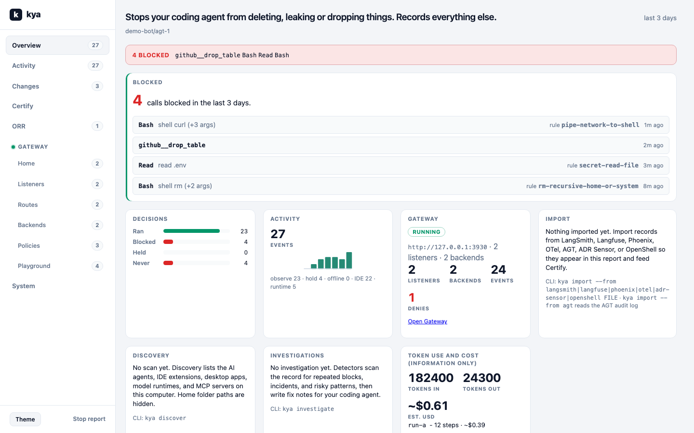
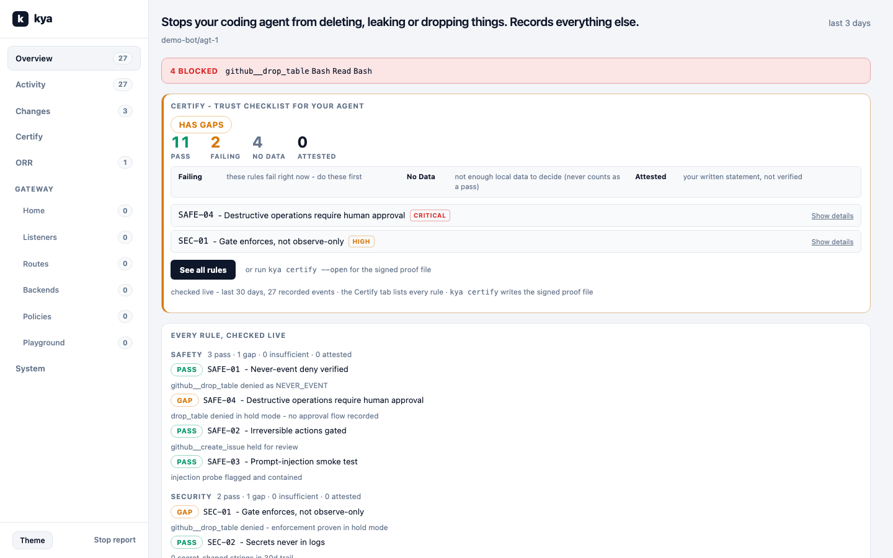
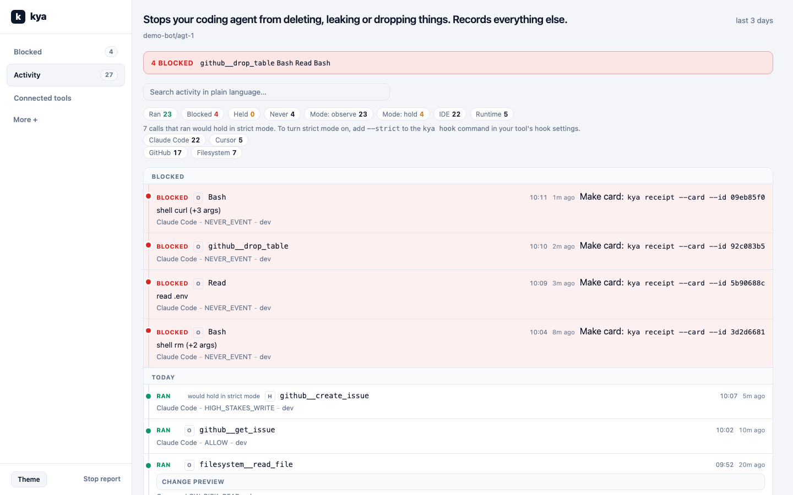
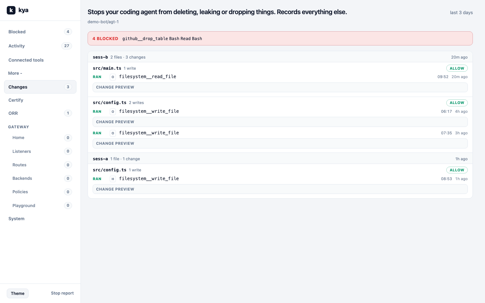
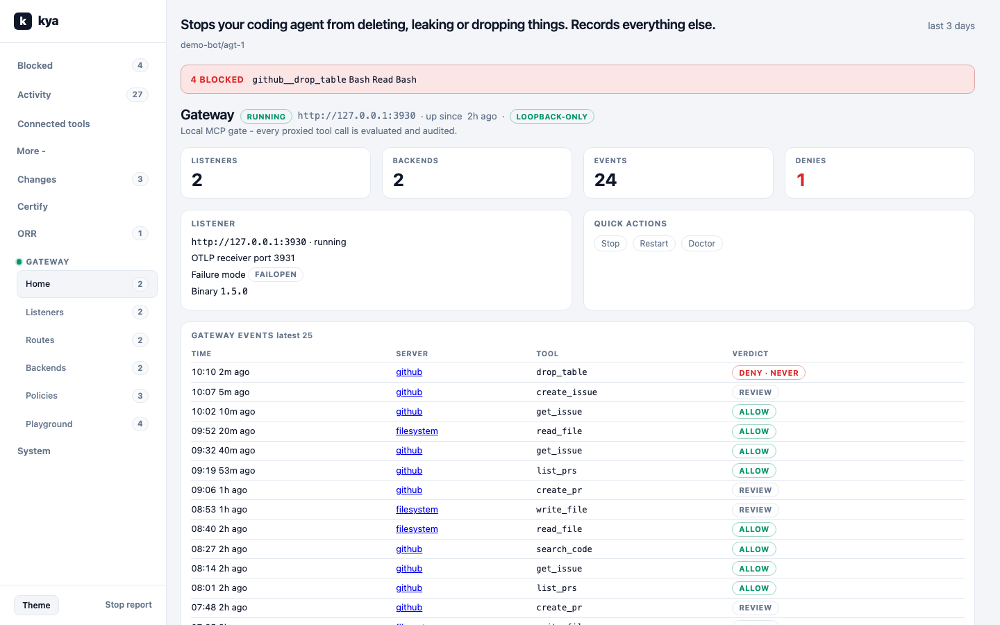

# Install and first run

Install channels, what `kya start` does, and the report screenshots. Moved out of the package README. Back to the [README](../README.md).

## One liner

```bash
npm i -g @shield-agent/kya@latest && kya start
# Permission denied (EACCES) on Linux? No sudo and no install needed:
npx @shield-agent/kya@latest start
```

Run it in your project directory. (From a clone of this repo, `./scripts/install-local.sh` replaces the npm install.)

After a yes, `kya start` ends with a guard proof: it sends three built-in demo calls (`rm -rf ~`, a read of `.env`, `curl | sh`) through the real hook in a throw-away home and prints `Blocked: rm -rf ~, read .env, curl | sh. Your agent is now guarded.` The demo calls are never saved to your trail. The last words appear only when a host hook is in place: with no hook-capable host, `kya start` shows the blocks and says no agent is guarded yet. `--dry-run` and a declined plan print no proof. The first panel of the report is **Blocked** (the last five blocked calls, or the three demo calls labelled as a demo before the first real block). Certify is its own tab and shows no count on the first screen.

`kya start` shows what it will change before it writes anything: each file, whether it is created or merged, and the exact keys it adds. In a terminal it then asks `Apply? [Y/n]` once. In a script or in CI add `--yes` (or set `KYA_YES=1`): without it, off a terminal, `kya start` prints the plan, writes nothing and exits 0. `kya start --dry-run` prints the plan and never writes. To undo everything, run `kya uninstall` (see [docs/uninstall.md](uninstall.md)).

If the install fails with `EACCES` (the global npm folder belongs to root, common on Linux), do not use `sudo`. Run without a global install: `npx @shield-agent/kya@latest start`. Or give npm a folder you own: `npm config set prefix ~/.npm-global`, add `~/.npm-global/bin` to your `PATH`, then run the install again.

More ways to install (same package; npm stays the reference path):

```bash
# Homebrew. Homebrew 7 may ask you to trust a third-party tap: run `brew tap The-Pixel-Boys/tap` first.
# The formula does not install the semantic-search runtime. Search stays lexical until you opt in (see Natural-language search).
brew install The-Pixel-Boys/tap/shield-kya

# Scoop (not yet verified on Windows)
scoop bucket add The-Pixel-Boys https://github.com/The-Pixel-Boys/scoop-bucket.git
scoop install shield-kya
```

Where each channel is counted. The table has no counts on purpose. Downloads are not installs and not people.

| Channel | Command or listing | Counted in |
|---|---|---|
| npm (reference) | `npm install -g @shield-agent/kya@latest` | npm downloads |
| Homebrew tap | `brew install The-Pixel-Boys/tap/shield-kya` | npm (the formula downloads the npm tarball) |
| Scoop | `scoop install shield-kya` | npm (the manifest downloads the npm tarball) |
| Python shim | `pip install shield-kya` (also needs the npm CLI on PATH) | PyPI downloads |
| VS Code extension | Marketplace: `shield-agent.shield-kya` (also needs the npm CLI) | VS Code Marketplace downloads |
| Plugins (Claude Code, Codex, Gemini CLI, Cursor) | see the sections below | npm (the plugin bootstrap runs `npm install`) |
| GitHub Action `kya-certify` | Marketplace listing | npm (each run installs the CLI from npm) |
| Dev Container Feature | not published yet | not counted |

Homebrew, Scoop, plugins and the GitHub Action fetch the npm package, so they are inside the npm count and are not added again.

Claude Code users can also install the [plugin](plugins.md#claude-code-plugin); GitHub Copilot CLI users the [Copilot CLI plugin](plugins.md#github-copilot-cli-plugin) (read its first paragraph before installing); Codex CLI users the [Codex plugin](plugins.md#codex-plugin); Gemini CLI users the [Gemini CLI extension](plugins.md#gemini-cli-extension). Cline users: `npm install -g @shield-agent/kya@latest`, then follow [`llms-install.md`](../llms-install.md). It is written so Cline can follow it; a Cline run from that file alone has not been tested yet.

That **inits** `.kya/`, **wires** local MCP for the hosts it finds (`.mcp.json` with Claude Code, `.cursor/mcp.json` with Cursor → `kya serve-mcp --stdio`), also **wires user-level configs for every installed host it detects** (`~/.claude.json`, `~/.kimi-code/`, `~/.grok/`, `~/.cursor/`, …), and **opens** the live activity report. The report runs in the background, so you get your terminal back. `kya stop` stops it. `kya receipt --open` reopens it. Cursor, Kiro, Qwen, Amp, Droid, Cline, and Grok pick the server up live with no restart (Kimi: just a new session). Claude Code, Codex, OpenCode, Gemini, Copilot CLI, and Kilo CLI load it on next launch. `claude --resume` keeps your conversation.











<!-- Local paths kept in package for offline viewers: assets/report-overview.png, assets/report-certify.png, assets/report-activity.png, assets/report-changes.png, assets/report-gateway.png (legacy: assets/activity-receipt.png) -->

```bash
kya start --dry-run   # print the plan, write nothing
kya start --yes       # apply without the question (scripts, CI; or KYA_YES=1)
kya start --no-open   # wire only
kya start --force     # rewrite MCP blocks
kya uninstall         # undo: removes only the keys KYA added (--project: this directory only)
# Receipt change previews (clipped + redacted): on by default for writes
# KYA_DIFF_PREVIEW=0 to disable
```
